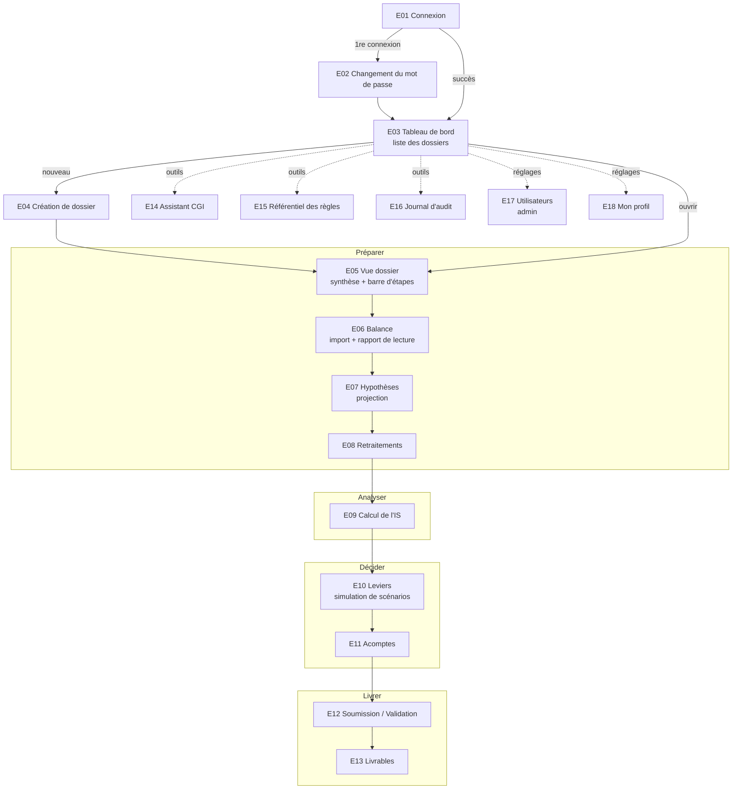

# 04 — Parcours utilisateur (appflow)

> **Objectif de ce document** : décrire dans quel ordre on passe d'un écran à l'autre, depuis la
> connexion jusqu'à la livraison d'un dossier validé. Le document 05 décrit ensuite le **contenu**
> de chaque écran.

---

## 1. Principe de navigation

L'outil suit la façon de travailler d'un cabinet, en **quatre temps** :

```
   PRÉPARER  ───▶  ANALYSER  ───▶  DÉCIDER  ───▶  LIVRER
  (balance,       (calcul de     (leviers,      (validation,
   hypothèses,     l'IS)          acomptes)      livrables)
   retraitements)
```

Trois principes d'ergonomie, repris de la V2 qui les avait bien posés :

1. **Chaque écran dit en tête à quoi il sert et ce qu'il faut y faire.** Un collaborateur junior ne
   doit jamais se demander « et maintenant ? ».
2. **Chaque étape se termine par un bouton vers l'étape suivante.**
3. **On peut revenir en arrière à tout moment** par la barre d'étapes, mais l'outil signale ce qui
   devient « à recalculer ».

---

## 2. Carte des écrans



> Le schéma `mermaid` s'affiche comme un diagramme dans GitHub, et dans VS Code avec une extension
> d'aperçu Mermaid. Sans rendu, il reste lisible comme une liste de flèches.

### Structure de la barre latérale

```
OptiFisc
───────────────
PILOTAGE
  Tableau de bord
  [Dossier ouvert : BATI-PLUS SARL 2026]   ← visible si un dossier est ouvert
OUTILS
  Assistant CGI
  Référentiel des règles
  Journal d'audit
RÉGLAGES
  Mon profil
  Utilisateurs                              ← visible pour l'administrateur seulement
───────────────
Salim A. · Collaborateur
Se déconnecter
```

---

## 3. Parcours A — Le collaborateur prépare un dossier

| # | Écran | Ce que fait le collaborateur | Ce que fait le système | Sortie vers |
|---|---|---|---|---|
| 1 | E01 Connexion | Saisit e-mail et mot de passe | Vérifie, ouvre la session, trace la connexion | E03 |
| 2 | E03 Tableau de bord | Voit **ses** dossiers sous forme de cartes : état, IS estimé, action urgente | Calcule « l'action urgente » (ex. « demande de réduction d'acompte avant le 10/08 ») | E04 ou E05 |
| 3 | E04 Création | Raison sociale, secteur, catégorie de taux, exercice | Crée le dossier `BROUILLON` | E05 |
| 4 | E05 Vue dossier | Lit la synthèse et la barre d'étapes | Indique la prochaine étape à faire | E06 |
| 5 | E06 Balance | Dépose le fichier, indique la date d'arrêté, lit le rapport, confirme | Lit, contrôle, enregistre (UC01) | E07 |
| 6 | E07 Hypothèses | Coefficient d'activité, dotations à passer, IS N-1, AIB, déficits | Prévisualise la balance projetée (UC06) | E08 |
| 7 | E08 Retraitements | Vérifie les lignes automatiques, saisit les montants demandés ou « néant » | Calcule, classe en 4 catégories, compte les saisies restantes (UC02) | E09 |
| 8 | E09 Calcul | Lit l'IS dû, le régime, le seuil de bascule, les alertes | Calcule (UC07), dossier `CALCULÉ` | E10 |
| 9 | E10 Leviers | Paramètre 1 à 3 scénarios, compare, en retient un | Recalcule avant/après (UC03) | E11 |
| 10 | E11 Acomptes | Lit l'échéancier, décide de demander une réduction ou non | Calcule la recommandation (UC08) | E12 |
| 11 | E12 Soumission | Relit la liste de contrôle, soumet | Vérifie la complétude, dossier `À VALIDER`, informe l'expert | E03 |

**Liste de contrôle avant soumission** (affichée sur E12, chaque point est vérifié par l'Application) :

- [ OUI ] Balance importée et contrôlée
- [ OUI ] Hypothèses de projection renseignées
- [ OUI ] Aucune règle de retraitement « non renseignée »
- [ OUI ] Calcul à jour (aucune donnée modifiée depuis)
- [ OUI ] Décision sur les acomptes enregistrée (y compris « pas de demande »)

## 4. Parcours B — L'expert-comptable valide

| # | Écran | Ce que fait l'expert | Ce que fait le système | Sortie vers |
|---|---|---|---|---|
| 1 | E03 Tableau de bord | Voit en premier les dossiers **« À valider »** | Trie par urgence (date limite de la prochaine échéance) | E05 |
| 2 | E05 Vue dossier | Lit le résumé de contrôle | Met en avant les points d'attention : règles non validées utilisées, alertes, montants importants | E09 / E08 (au besoin) |
| 3 | E08 / E09 | Descend dans le détail d'un montant | Affiche la ligne de la piste d'audit (règle, article, base, formule) | E12 |
| 4 | E12 Validation | **Valide**, ou **renvoie** avec un commentaire | Fige le résultat, dossier `VALIDÉ` ; ou renvoie `EN PRÉPARATION` | E13 ou E03 |
| 5 | E13 Livrables | Génère la note, le dossier Excel et la lettre au DGI | Produit les fichiers, enregistre leurs empreintes, dossier `LIVRÉ` | E03 |

## 5. Parcours C — Les outils (accessibles à tout moment)

- **E14 Assistant CGI** : accessible depuis la barre latérale, et depuis un lien « Voir l'article »
  sur chaque ligne de retraitement ou de levier. Il s'ouvre alors avec l'article déjà cherché.
- **E15 Référentiel** : consultation pour tous ; bouton « Valider la règle » pour l'expert (UC10).
- **E16 Journal** : chronologie filtrable (UC11).

## 6. Règles de navigation (garde-fous)

| Situation | Comportement |
|---|---|
| Pas connecté | Tout écran redirige vers E01. |
| Session expirée (30 min) | Retour à E01 avec le message « Session expirée ». Les saisies déjà enregistrées sont conservées. |
| Étape non accessible (ex. Calcul sans balance) | L'étape est grisée dans la barre, avec une infobulle « Importez d'abord la balance ». |
| Donnée modifiée après le calcul | Bandeau orange « Le calcul n'est plus à jour : recalculer » sur E09 à E12. |
| Dossier `À VALIDER`, `VALIDÉ` ou `LIVRÉ` | Tous les champs sont en lecture seule, avec un bandeau d'état et la personne qui détient la main. |
| Droit manquant | Bouton absent. Si l'action est tentée quand même : message « Accès refusé », tracé. |

## 7. États de la barre d'étapes

```
 ✓ Balance  ─  ✓ Hypothèses  ─  ● Retraitements (3 saisies restantes)  ─  ○ Calcul  ─  ○ Leviers  ─  ○ Acomptes  ─  ○ Livrer
 fait            fait             en cours                                 à faire      à faire       à faire        à faire
```

L'état de chaque étape est **calculé par l'Application** à partir du dossier. L'écran se contente de
l'afficher, il ne décide pas lui-même si une étape est terminée.

---

## Décisions à valider

- [ OUI ] **D4.1** 18 écrans (E01 à E18) et leur enchaînement.
- [ OUI ] **D4.2** Les hypothèses de projection sont un écran séparé (E07) et non une partie de l'écran Balance (comme dans la V2). Motif : distinguer clairement « ce que dit la balance » de « ce que suppose le collaborateur ».
- [ OUI ] **D4.3** Liste de contrôle avant soumission (§3).
- [ OUI ] **D4.4** Pas de page d'accueil publique avant la connexion (la V2 en avait une). Motif : outil interne au cabinet.
